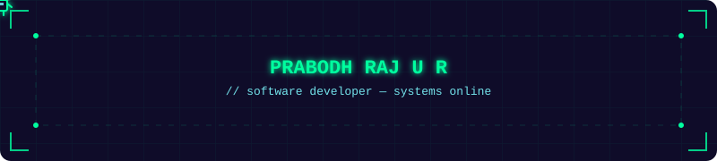

<div align="center">




</div>

---

```bash
prabodh@dev:~$ whoami
```

```yaml
name: Prabodh Raj U R
role: Software Developer
experience: 3x Intern — full-stack delivery, LLM systems in production, deployment pipelines
education: B.Tech CSE @ SRM IST (2024–2028)
```

```bash
prabodh@dev:~$ status
```

```diff
+ [ACTIVE]  Building frontend experiences with React & Next.js
+ [ACTIVE]  Shipping full-stack products & deployment pipelines
+ [ACTIVE]  Engineering AI agent workflows for real-world backends
+ [ACTIVE]  Working with distributed systems · Cloud architecture · MLOps
```

---

<div align="center">

<a href="https://www.linkedin.com/in/prabodhrajur/"></a>
<a href="https://www.prabodhportfolio.com"></a>
<a href="mailto:prabodhrajmow@gmail.com"></a>


</div>
